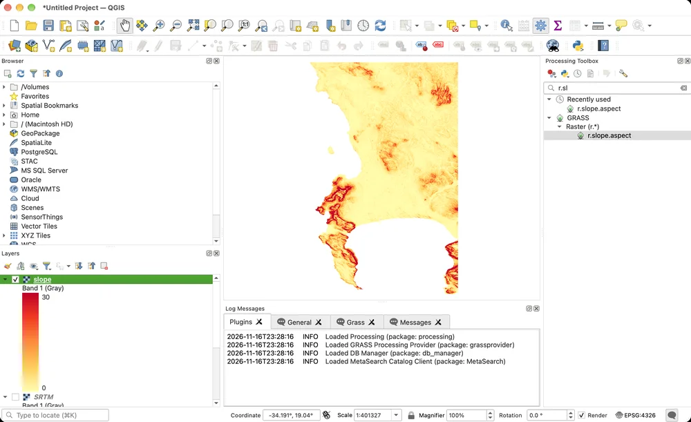
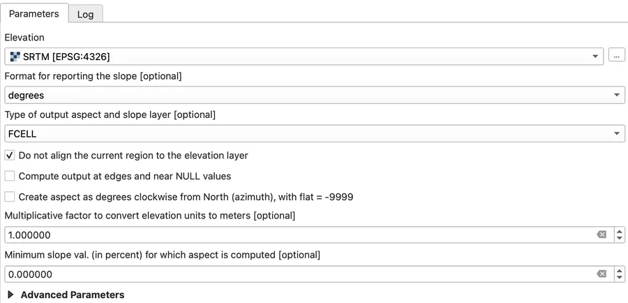
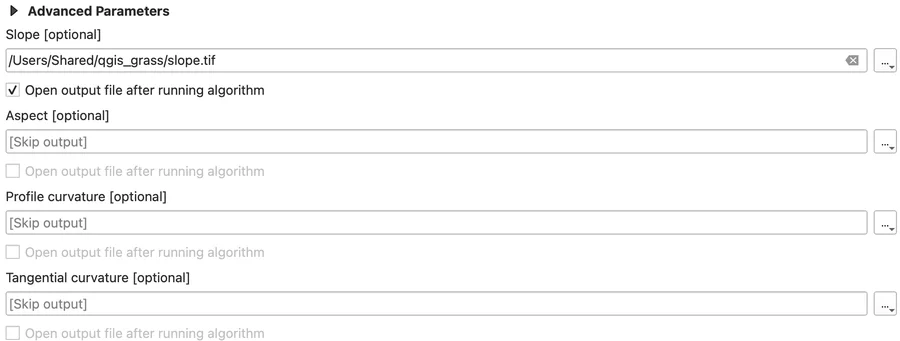
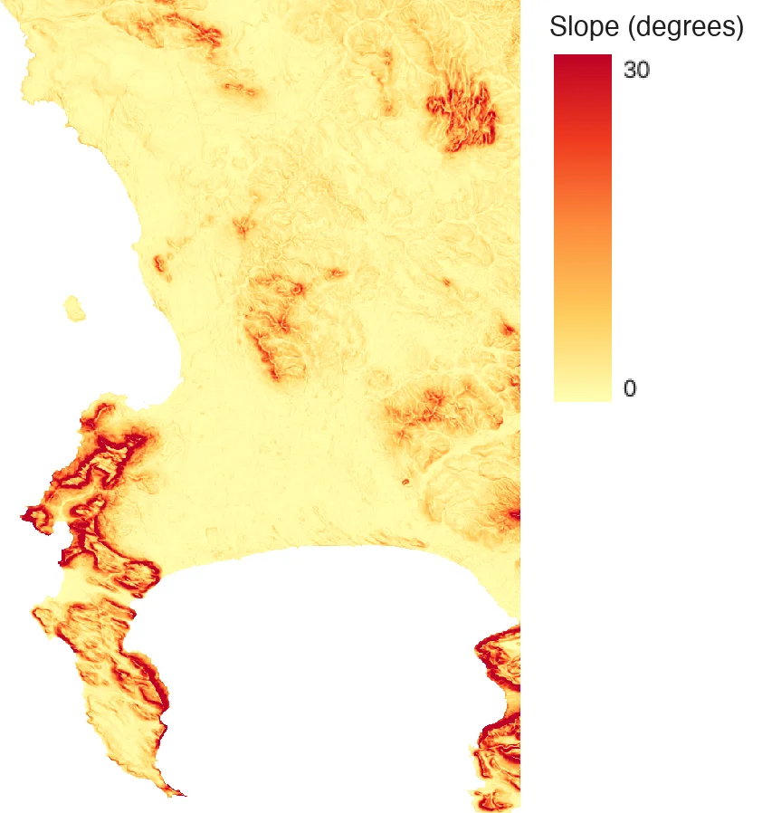
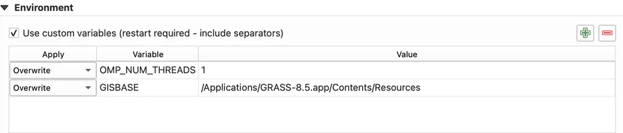

QGIS can run GRASS tools from its Processing Toolbox. You pick a layer, fill
in a dialog, and QGIS runs GRASS for you in the background. You get GRASS
analysis without leaving QGIS or setting up a GRASS project yourself.

This tutorial shows how to run a GRASS tool on a raster layer, what QGIS does
when you click **Run**, and what to do if QGIS does not find GRASS.

## Install QGIS and GRASS

You need both programs:

- QGIS from <https://qgis.org/download/>. If you are not sure which version
  to take, the download page recommends the LTR.
- GRASS from <https://grass.osgeo.org/download/>.

On Windows with the OSGeo4W installer, the GRASS download page says you need
the `qgis*-grass-plugin` packages to get GRASS in QGIS Processing. The QGIS
app for macOS from the download page does not include GRASS, so install GRASS
separately and see [GRASS not found on macOS](#grass-not-found-on-macos).
On macOS you can also install QGIS with GRASS support from MacPorts, as
described in the
[QGIS installation guide](https://www.qgis.org/resources/installation-guide/#macports).

## Run a GRASS tool

The GRASS tools are in the Processing Toolbox (**Processing ‣ Toolbox**),
under **GRASS**.



This example computes slope from `SRTM.tif`, the elevation model around
Cape Town from the
[QGIS training data](https://github.com/qgis/QGIS-Training-Data).
Download
[SRTM.tif](https://github.com/qgis/QGIS-Training-Data/raw/master/exercise_data/more_analysis/DEM/SRTM.tif)
and add it with **Layer ‣ Add Layer ‣ Add Raster Layer…**. With GRASS 8.5.0
and this latitude-longitude data, first follow
[Wrong rows in the slope map](#wrong-rows-in-the-slope-map).

Search for `r.slope.aspect` in the Processing Toolbox and open it. Choose
`SRTM` as **Elevation**. Leave **Multiplicative factor to convert elevation
units to meters** at 1.0, because the elevation is in meters.



The tool has nine outputs, and by default QGIS computes all of them and
adds each one to the map. To get only the slope:

- Next to **Slope**, click **…** and choose **Save to File…**. Pick the file
  with the dialog. A path typed by hand with `~` fails, because QGIS passes
  it to GRASS as it is.
- For each of the other outputs, click **…** and choose **Skip Output**.
  QGIS then leaves them out of the GRASS command, so GRASS does not compute
  them at all.



Click **Run**. If you run the tool again, check **Elevation** first: after a
run, QGIS may select the new slope layer there.

Most of this area is gentle, so a color ramp from 0 to 30 degrees shows it
better than one up to the steepest cell. For the map below, open the layer's
**Properties ‣ Symbology**, choose **Singleband pseudocolor**, set **Min**
to 0 and **Max** to 30, and pick the **YlOrRd** color ramp.

{.preview-image width=70% fig-align="center"}

## What QGIS does behind the scenes

The **Log** tab of the dialog shows the GRASS commands QGIS runs. QGIS
creates a temporary GRASS project in the CRS of the layer and gives the maps
temporary names. Then it imports the layer, sets the computational region to
its extent and resolution, runs the tool and exports the output:

```
r.in.gdal input="/Users/Shared/qgis_grass/SRTM.tif" band=1 output="rast_6afb8857b82624" --overwrite -o
g.region n=-33.454002103 s=-34.374687925 e=18.872219805 w=18.269894211 res=0.0008330921078838172
r.slope.aspect elevation=rast_6afb8857b82624 format="degrees" precision="FCELL" -a zscale=1 min_slope=0 slope=slopeec7496369fc14332a68c5751f610f9c6 --overwrite
g.region raster=slopeec7496369fc14332a68c5751f610f9c6
r.out.gdal -t -m input="slopeec7496369fc14332a68c5751f610f9c6" output="/Users/Shared/qgis_grass/slope.tif" format="GTiff" createopt="TFW=YES,COMPRESS=LZW" --overwrite
```

The red `ERROR 6` line about `SetColorTable()` in the log is harmless: the
file is still written.

## Not every GRASS tool is in QGIS

The toolbox has most GRASS raster, vector and imagery tools. It has no
temporal (`t.*`), 3D raster (`r3.*`), database (`db.*`) or display (`d.*`)
tools. GRASS addons you install do not show up either, because QGIS only
lists tools it has a description file for. For those, use GRASS itself,
for example with the
[Get started with GRASS GUI](../get_started/fast_track.qmd) tutorial.

## Troubleshooting

### GRASS not found on macOS

If the QGIS app for macOS does not find a separately installed GRASS, the
GRASS tools are missing from the Processing Toolbox, or opening one shows
"Could not locate GRASS folder. Please make sure that GRASS is correctly
installed before running GRASS algorithms."

Tell QGIS where GRASS is with the `GISBASE` variable:

1. Open **Settings ‣ Options…** and go to the **System** tab.
2. Under **Environment**, check **Use custom variables**.
3. Click the green **+** and set **Apply** to `Overwrite`, **Variable** to
   `GISBASE` and **Value** to the `Contents/Resources` folder of your GRASS
   app, for example `/Applications/GRASS-8.5.app/Contents/Resources`.
4. Click **OK**, then quit and reopen QGIS.

### Wrong rows in the slope map

In GRASS 8.5.0, *r.slope.aspect* running on several threads can write a
wrong row into the slope map of latitude-longitude data
([#8189](https://github.com/OSGeo/grass/issues/8189)). QGIS runs GRASS tools
with the default number of threads. To make GRASS use one, add a row in the
same **Environment** table: `Overwrite`, `OMP_NUM_THREADS`, `1`, and restart
QGIS. Every GRASS tool you run from QGIS then uses one thread, which can make
tools that run in parallel slower on large maps. Remove the row once a GRASS
release includes the fix ([#8207](https://github.com/OSGeo/grass/pull/8207)).



Tested on macOS with QGIS 3.44.15, QGIS 4.2.3 and GRASS 8.5.0. Not tested
on Windows or Linux.
